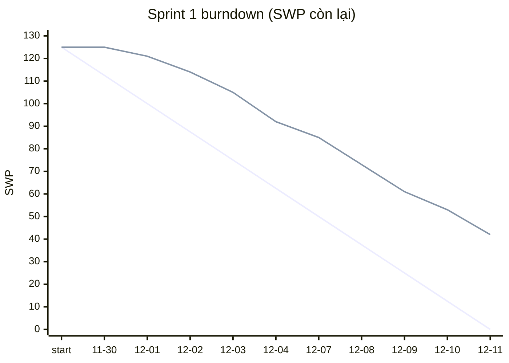

# Báo cáo tiến độ — Sprint 1

**Iteration trên Project:** `Sprint 1` (trường Sprint) · **Khoảng thời gian giả lập:** 2026-11-30 (T2) → 2026-12-11 (T6), 10 ngày làm việc · **Ngày chốt số liệu:** 2026-12-11 · Project: [https://github.com/users/duyl-2064/projects/2](https://github.com/users/duyl-2064/projects/2)

> Đây là sprint **giả lập**: trạng thái issue trên Project được cập nhật như sau một sprint chạy thật (thao tác ngày 24/10/2026). Ngày xong của từng issue nằm ở trường "Done date (sim)", không phải ngày đóng issue trên GitHub. Lịch sprint bám mốc RFP: 構築・テスト 18 tuần từ 2026-11-30 = Sprint 1–9, UAT từ 2027-04-05, go-live 2027-06-01 (PREMISE A-02).

**Tóm tắt cho khách hàng:** Sprint 1 làm xong **83/125 SWP (26/37 issue)**: nền kỹ thuật (CI, migration 0002a/0002b, audit log + correlation ID, RBAC helper, JST, file đính kèm), bảng version ngưỡng nhiệt + resolver + bảng 逸脱, thiết kế 2 màn P0 (L1-SCR-404, L1-SCR-701) và kế hoạch kiểm thử hiệu năng. Còn **4 issue bị chặn**, 3 trong số đó chờ thông tin từ phía Yuki (số dư giờ lái đầu kỳ, câu hỏi 改善基準告示, schema CSV ERP). Theo tốc độ thật của Sprint 1, phần còn lại cần ~11.0 sprint trong khi còn 8 sprint tới hết 構築 — cần quyết định phạm vi trước 2026-12-18 (rủi ro R-03, R-07).

## 1. Trạng thái

### Phạm vi Sprint 1 (37 issue lá, 125 SWP)

| Trạng thái | Số issue | Tổng SWP | Ghi chú |
|---|---|---|---|
| Done | 26 | 83 | DoD đạt, PR merge; ngày xong ở trường Done date (sim) |
| In Review | 4 | 21 | [#13](https://github.com/duyl-2064/aidd-for-sdm-lab5/issues/13): PR mở 12/10, còn 2 comment về mã 409 khi khác payload [#22](https://github.com/duyl-2064/aidd-for-sdm-lab5/issues/22): Chờ auditor (PO) xem màn tra event_log [#55](https://github.com/duyl-2064/aidd-for-sdm-lab5/issues/55): Golden test xanh 6/7 bẫy; bẫy T6 chờ S060201 (port engine) để so SQL [#275](https://github.com/duyl-2064/aidd-for-sdm-lab5/issues/275): Spec L1-SCR-604 gửi PO 12/11, chưa duyệt |
| In Progress | 3 | 14 | [#43](https://github.com/duyl-2064/aidd-for-sdm-lab5/issues/43): Chỉ bắt đầu được 12/9 vì chờ I0109 (storage) [#142](https://github.com/duyl-2064/aidd-for-sdm-lab5/issues/142): Rà code thấy 11 chỗ đọc sensor.threshold_* (ước 4–5 chỗ), còn 5 chỗ ở SCR-011 [#341](https://github.com/duyl-2064/aidd-for-sdm-lab5/issues/341): Thiết kế công cụ migration xong 60%, chờ mẫu 7 file hiện hành |
| Blocked | 4 | 7 | [#56](https://github.com/duyl-2064/aidd-for-sdm-lab5/issues/56): Thiếu khai báo phụ thuộc vào S060201 (RPC allocate_order chưa làm) — lỗi backlog, đã bổ sung [#124](https://github.com/duyl-2064/aidd-for-sdm-lab5/issues/124): Yuki chưa trả lời nguồn số dư 拘束/運転 (hỏi 12/1, nhắc 12/8) [#126](https://github.com/duyl-2064/aidd-for-sdm-lab5/issues/126): Còn 5/16 câu SCR-014 chưa trả lời: 労使協定, 長距離便, デジタコ, điểm bắt đầu 始業, migrate lịch sử [#335](https://github.com/duyl-2064/aidd-for-sdm-lab5/issues/335): Chưa nhận schema CSV ERP (Yuki sở hữu, Q-07 LAB-1) |
| **Tổng** | **37** | **125** | |

### Toàn backlog sau Sprint 1 (258 issue lá, 1000 SWP)

| Trạng thái | Số issue | Tổng SWP | Ghi chú |
|---|---|---|---|
| Done | 26 | 83 | Toàn bộ thuộc Sprint 1 (xem bảng trên) |
| In Review | 4 | 21 | Toàn bộ thuộc Sprint 1 (xem bảng trên) |
| In Progress | 3 | 14 | Toàn bộ thuộc Sprint 1 (xem bảng trên) |
| Blocked | 4 | 7 | Toàn bộ thuộc Sprint 1 (xem bảng trên) |
| Todo | 221 | 875 | 183 issue đã xếp Sprint 2–9; 38 issue chưa xếp được (vượt năng lực, R-03) |
| **Tổng** | **258** | **1000** | |

**Đã giao trong sprint (bằng chứng = DoD của issue đạt, PR đã merge):**

- **E01** Nền kỹ thuật & DB dùng chung (ADR-01/02/06, migration 0002/0008/0009): [#5](https://github.com/duyl-2064/aidd-for-sdm-lab5/issues/5) CI GitHub Actions (4), [#7](https://github.com/duyl-2064/aidd-for-sdm-lab5/issues/7) 0002a (3), [#8](https://github.com/duyl-2064/aidd-for-sdm-lab5/issues/8) 0002b (4), [#11](https://github.com/duyl-2064/aidd-for-sdm-lab5/issues/11) ALTER event_log +5 cột, current_actor(), log_event() đọc app.* + trigger cho master (5), [#12](https://github.com/duyl-2064/aidd-for-sdm-lab5/issues/12) Middleware X-Correlation-Id + helper gọi RPC + event đăng nhập/đăng xuất (5), [#15](https://github.com/duyl-2064/aidd-for-sdm-lab5/issues/15) Helper requireRole() + bảng ma trận role × API (gộp ②-c 17 màn) (4), [#17](https://github.com/duyl-2064/aidd-for-sdm-lab5/issues/17) Chuẩn hoá ngày nghiệp vụ theo JST (view, active_contract, helper dùng chung) (5), [#18](https://github.com/duyl-2064/aidd-for-sdm-lab5/issues/18) Seed/fixture (5), [#19](https://github.com/duyl-2064/aidd-for-sdm-lab5/issues/19) Storage đính kèm dùng chung (5)
- **E02** SCR-000/001 共通レイアウト・ログイン: [#24](https://github.com/duyl-2064/aidd-for-sdm-lab5/issues/24) SCR-000 (4), [#25](https://github.com/duyl-2064/aidd-for-sdm-lab5/issues/25) Middleware/login (4)
- **E04** SCR-003/004 入荷一覧・入荷検品: [#33](https://github.com/duyl-2064/aidd-for-sdm-lab5/issues/33) SCR-003 (3), [#40](https://github.com/duyl-2064/aidd-for-sdm-lab5/issues/40) FE bỏ ZONE_RANGE hard-code, hiện ngưỡng + 版, text cách ly sinh từ master vị trí (2), [#45](https://github.com/duyl-2064/aidd-for-sdm-lab5/issues/45) Làm rõ với Yuki (2)
- **E06** SCR-006/007/008 出荷指示・引当・日付逆転: [#52](https://github.com/duyl-2064/aidd-for-sdm-lab5/issues/52) Migration 0004 (1), [#63](https://github.com/duyl-2064/aidd-for-sdm-lab5/issues/63) SCR-006/007 UI (3)
- **E08** SCR-010 納品確認（POD）: [#83](https://github.com/duyl-2064/aidd-for-sdm-lab5/issues/83) SCR-010 (3), [#84](https://github.com/duyl-2064/aidd-for-sdm-lab5/issues/84) Làm rõ với Yuki (1)
- **E09** SCR-011 温度アラーム: [#93](https://github.com/duyl-2064/aidd-for-sdm-lab5/issues/93) Làm rõ với Yuki (1)
- **E13** SCR-016 温度帯閾値・ルール版管理 (2 tab): [#140](https://github.com/duyl-2064/aidd-for-sdm-lab5/issues/140) Bảng temp_threshold_version/temp_threshold/rule_version_approval + CHECK người duyệt ≠ người tạo + seed v1 (3), [#141](https://github.com/duyl-2064/aidd-for-sdm-lab5/issues/141) Hàm active_temp_threshold(zone, ts) fail-closed + test biên (2), [#143](https://github.com/duyl-2064/aidd-for-sdm-lab5/issues/143) Bảng deviation, deviation_lot, deviation_evidence (dời từ 0006 lên 0003) (3), [#156](https://github.com/duyl-2064/aidd-for-sdm-lab5/issues/156) Làm rõ với Yuki (2)
- **E14** Màn LAB-1 chưa có detail design (43 màn, break theo pattern 17 màn LAB-4): [#259](https://github.com/duyl-2064/aidd-for-sdm-lab5/issues/259) [Thiết kế] L1-SCR-404 オフライン同期状況 (PWA) (3), [#295](https://github.com/duyl-2064/aidd-for-sdm-lab5/issues/295) [Thiết kế] L1-SCR-701 トレース検索 (3)
- **E15** Tích hợp, migration dữ liệu, NFR chưa có detail design: [#344](https://github.com/duyl-2064/aidd-for-sdm-lab5/issues/344) [Thiết kế] Kiểm thử hiệu năng (3)

## 2. Burndown

Đơn vị: SWP còn lại của phạm vi Sprint 1 vào cuối mỗi ngày. "Kế hoạch" giảm đều về 0; "Thực tế" chỉ trừ khi issue Done (In Review chưa tính).

(Đường trên đồ thị: thứ nhất = kế hoạch, thứ hai = thực tế.)

| Ngày | Kế hoạch còn lại | Thực tế còn lại | Lệch | Issue Done trong ngày |
|---|---|---|---|---|
| 2026-11-30 | 112.5 | 125 | +12.5 | — |
| 2026-12-01 | 100.0 | 121 | +21.0 | [#7](https://github.com/duyl-2064/aidd-for-sdm-lab5/issues/7), [#52](https://github.com/duyl-2064/aidd-for-sdm-lab5/issues/52) |
| 2026-12-02 | 87.5 | 114 | +26.5 | [#5](https://github.com/duyl-2064/aidd-for-sdm-lab5/issues/5), [#140](https://github.com/duyl-2064/aidd-for-sdm-lab5/issues/140) |
| 2026-12-03 | 75.0 | 105 | +30.0 | [#8](https://github.com/duyl-2064/aidd-for-sdm-lab5/issues/8), [#18](https://github.com/duyl-2064/aidd-for-sdm-lab5/issues/18) |
| 2026-12-04 | 62.5 | 92 | +29.5 | [#11](https://github.com/duyl-2064/aidd-for-sdm-lab5/issues/11), [#15](https://github.com/duyl-2064/aidd-for-sdm-lab5/issues/15), [#25](https://github.com/duyl-2064/aidd-for-sdm-lab5/issues/25) |
| 2026-12-07 | 50.0 | 85 | +35.0 | [#17](https://github.com/duyl-2064/aidd-for-sdm-lab5/issues/17), [#141](https://github.com/duyl-2064/aidd-for-sdm-lab5/issues/141) |
| 2026-12-08 | 37.5 | 73 | +35.5 | [#12](https://github.com/duyl-2064/aidd-for-sdm-lab5/issues/12), [#24](https://github.com/duyl-2064/aidd-for-sdm-lab5/issues/24), [#344](https://github.com/duyl-2064/aidd-for-sdm-lab5/issues/344) |
| 2026-12-09 | 25.0 | 61 | +36.0 | [#19](https://github.com/duyl-2064/aidd-for-sdm-lab5/issues/19), [#143](https://github.com/duyl-2064/aidd-for-sdm-lab5/issues/143), [#84](https://github.com/duyl-2064/aidd-for-sdm-lab5/issues/84), [#259](https://github.com/duyl-2064/aidd-for-sdm-lab5/issues/259) |
| 2026-12-10 | 12.5 | 53 | +40.5 | [#40](https://github.com/duyl-2064/aidd-for-sdm-lab5/issues/40), [#93](https://github.com/duyl-2064/aidd-for-sdm-lab5/issues/93), [#45](https://github.com/duyl-2064/aidd-for-sdm-lab5/issues/45), [#83](https://github.com/duyl-2064/aidd-for-sdm-lab5/issues/83) |
| 2026-12-11 | 0.0 | 42 | +42.0 | [#33](https://github.com/duyl-2064/aidd-for-sdm-lab5/issues/33), [#63](https://github.com/duyl-2064/aidd-for-sdm-lab5/issues/63), [#156](https://github.com/duyl-2064/aidd-for-sdm-lab5/issues/156), [#295](https://github.com/duyl-2064/aidd-for-sdm-lab5/issues/295) |

**Lệch kế hoạch ở đâu:**
- **Lệch ngay từ đầu sprint, lớn nhất ngày 3 (30 SWP sau kế hoạch):** migration 0002, CI và bảng ngưỡng phải xong trước, các issue khác phụ thuộc chúng nên 3 ngày đầu chỉ đóng được issue nhỏ. Đường thực tế đi song song kế hoạch từ ngày 4 nhưng không bắt kịp. Bài học: sprint nền nên xếp ít việc phụ thuộc hơn, hoặc tính năng lực nửa đầu sprint thấp hơn.
- **[#19](https://github.com/duyl-2064/aidd-for-sdm-lab5/issues/19) (storage đính kèm) xong ngày 9/12 thay vì 3/12** kéo theo [#43](https://github.com/duyl-2064/aidd-for-sdm-lab5/issues/43) (form kiểm FR-REC-02) mới bắt đầu ngày 9/12 → chuyển sang Sprint 2.
- **[#142](https://github.com/duyl-2064/aidd-for-sdm-lab5/issues/142) lớn hơn ước tính:** rà code thấy 11 chỗ đọc `sensor.threshold_*`, nhiều gấp đôi dự kiến → còn dở.
- **4 issue Blocked (7 SWP)**: điểm nhỏ nhưng chặn đường găng: 3 chờ khách (số dư giờ lái, câu hỏi 改善基準告示, schema ERP), 1 do backlog thiếu khai báo phụ thuộc ([#56](https://github.com/duyl-2064/aidd-for-sdm-lab5/issues/56) cần RPC [#54](https://github.com/duyl-2064/aidd-for-sdm-lab5/issues/54) chưa xếp lịch). Đã bổ sung phụ thuộc vào issue.
- Kết thúc sprint còn **42 SWP** (In Review 21, In Progress 14, Blocked 7) chuyển sang Sprint 2. Tốc độ thật: **83 SWP/sprint** so với kế hoạch 125.

## 3. Rủi ro trễ

| # | Rủi ro | Issue | Ảnh hưởng tới mốc nào | Hành động | Ai làm, khi nào |
|---|---|---|---|---|---|
| R-01 | Yuki chưa cung cấp số dư 拘束/運転 12 tháng của tài xế. Thiếu số dư thì engine fail-closed chặn **mọi** route từ ngày go-live (PREMISE P-06) | [#124](https://github.com/duyl-2064/aidd-for-sdm-lab5/issues/124) (Blocked), [#125](https://github.com/duyl-2064/aidd-for-sdm-lab5/issues/125), [#111](https://github.com/duyl-2064/aidd-for-sdm-lab5/issues/111) | Import số dư dự kiến Sprint 4 (2027-01-11); go-live 2027-06-01 | Đưa vào họp tuần với 輸送オーナー 2026-12-14; đề xuất phương án dự phòng: lấy 3 tháng gần nhất từ 配車表 hiện hành nếu không có 12 tháng; chốt định dạng CSV trước 2026-12-18 | BrSE — 14/12; PM quyết phương án dự phòng 18/12 |
| R-02 | 5 câu SCR-014 chưa trả lời (労使協定, 長距離便, デジタコ, mốc 始業, migrate lịch sử) → tham số C02/C03/C05/C07 chưa chắc | [#126](https://github.com/duyl-2064/aidd-for-sdm-lab5/issues/126) (Blocked), [#108](https://github.com/duyl-2064/aidd-for-sdm-lab5/issues/108), [#111](https://github.com/duyl-2064/aidd-for-sdm-lab5/issues/111), [#151](https://github.com/duyl-2064/aidd-for-sdm-lab5/issues/151) | Engine giờ lái Sprint 2–3 (đến 2027-01-08) | Làm engine theo giá trị luật + toggle tắt (PREMISE P-05); tham số để ở bảng rule version nên khách trả lời chỉ đổi dữ liệu. Hạn trả lời 2026-12-18 | BrSE hỏi lại 14/12; BE-2 làm theo giá trị mặc định từ Sprint 2 |
| R-03 | Backlog vượt năng lực: **38 issue (155 SWP ≈ 620h)** không xếp được vào Sprint 1–9 với team 9 người (PREMISE A-01) | E14: các màn P1/P2 chưa có sprint (cột Sprint trống trên Project) | Kết thúc 構築 2027-04-02; bắt đầu UAT 2027-04-05 | Họp PO 2026-12-16: (a) dời các màn P2 (棚卸, sanitation, training, visitor…) sang giai đoạn 2 sau go-live, hoặc (b) thêm 1 BE + 1 FE từ Sprint 3. Ghi quyết định vào PREMISE | PM + PO (Yuki) — 16/12, quyết định 18/12 |
| R-04 | Hạ tầng AWS chấm 10 SWP (40h) trong khi LAB-1 ước 8 MM; có thể chưa có môi trường UAT đúng hạn | [#348](https://github.com/duyl-2064/aidd-for-sdm-lab5/issues/348), [#347](https://github.com/duyl-2064/aidd-for-sdm-lab5/issues/347) | Môi trường UAT 2027-04-05; rehearsal migration 1 | Làm xong thiết kế [#347](https://github.com/duyl-2064/aidd-for-sdm-lab5/issues/347) trong Sprint 3, tách [#348](https://github.com/duyl-2064/aidd-for-sdm-lab5/issues/348) theo môi trường/thành phần và chấm SWP lại; giữ Supabase làm môi trường tạm cho UAT nếu trễ | BE-3 + PM — hết Sprint 3 (2027-01-08) |
| R-05 | Chưa có schema CSV ERP (Yuki sở hữu) → chưa thiết kế được nạp đơn/入荷予定 | [#335](https://github.com/duyl-2064/aidd-for-sdm-lab5/issues/335) (Blocked), [#336](https://github.com/duyl-2064/aidd-for-sdm-lab5/issues/336) | Rehearsal migration 1; nhận đơn thật khi UAT | Xin file mẫu + schema trước 2026-12-18; trong lúc chờ làm parser có tầng mapping cấu hình được | BrSE — 14/12; BE-4 làm parser Sprint 3 |
| R-06 | Backlog có thể còn thiếu khai báo phụ thuộc như [#56](https://github.com/duyl-2064/aidd-for-sdm-lab5/issues/56) → [#54](https://github.com/duyl-2064/aidd-for-sdm-lab5/issues/54) | [#56](https://github.com/duyl-2064/aidd-for-sdm-lab5/issues/56) (Blocked), [#54](https://github.com/duyl-2064/aidd-for-sdm-lab5/issues/54) | Tốc độ Sprint 2 | Xếp [#54](https://github.com/duyl-2064/aidd-for-sdm-lab5/issues/54) đầu Sprint 2; rà các issue "Route Handler gọi rpc" và "UI dùng API" còn lại xem có thiếu phụ thuộc không | BE-1 — 14/12 |
| R-07 | Tốc độ thật 83 SWP/sprint (kế hoạch 125); giữ tốc độ này thì phần còn lại 917 SWP cần ~11.0 sprint, còn 8 sprint | Toàn backlog | Kết thúc 構築 2027-04-02 | Xếp Sprint 2 theo tốc độ thật (~83 SWP) thay vì năng lực lý thuyết; đo lại sau Sprint 2–3 rồi mới chốt phương án R-03 | PM — lập kế hoạch Sprint 2 ngày 14/12 |
